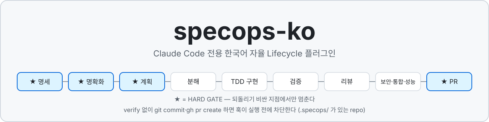
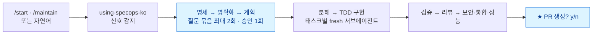
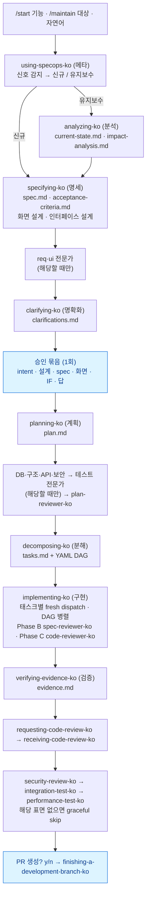
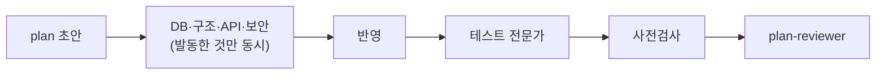
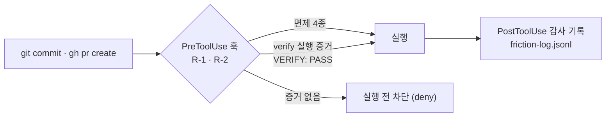

<p align="center">
  
</p>

# devFSD

**개발 자율주행(devFSD) — Claude Code 전용 한국어 자율 Lifecycle 플러그인** (v3.0.0)

> 감독형 자율주행이다 — 설계 승인과 PR 병합은 사람이 한다. (이전 이름 specops-ko)

[](https://github.com/andyko18/devFSD/releases)
[](https://github.com/andyko18/devFSD/actions/workflows/test.yml)
[](LICENSE)


슬래시 1회 또는 자연어 1회로 **spec → clarify → plan → decompose → TDD implement → verify → review → security → integration-test → performance-test → PR** 전 단계를 자동으로 이어서 진행한다.
한글로는 **명세 → 명확화 → 계획 → 분해 → TDD 구현 → 검증 → 리뷰 → 보안 → 통합 테스트 → 성능 테스트 → PR** 이다.

## 왜 쓰나

LLM 에이전트에게 개발을 맡길 때 반복되는 실패를, 프롬프트가 아니라 런타임의 장치로 막는다.

| 이런 일이 반복된다 | devFSD 의 답 |
|---|---|
| 🔁 단계마다 다음 지시를 다시 해야 한다 | 🔗 **자율 chain** — 각 스킬 본문의 `## 다음 skill` 이 다음 단계를 강제한다. 단계마다 지시할 필요가 없다 |
| 🧠 세션이 끊기면 맥락이 사라진다 | 📁 **파일이 기억한다** — 모든 산출물은 `.specops/<FID>/` 에 남는다. 세션이 끊겨도 파일만 읽고 이어간다 |
| 🙈 검증하지 않고 "다 됐다"고 말한다 | ✅ **주장은 증거로만** — verify 없이 `git commit`·`gh pr create` 하면 훅이 실행 전에 차단한다 (`.specops/` 가 있는 repo 에서) |
| 🔍 한 사람(한 리뷰어)이 모든 분야를 놓치지 않고 보기 어렵다 | 🧑‍🔬 **분야 전문가 7종** — 요구사항·화면·DB·구조·API·보안·테스트를 그 분야만 보는 별도 패스가 다시 본다. [전문가 패스](#전문가-패스) 참조 |
| 🙋 확인 요청이 너무 잦다 | 🗳️ **질문 묶음 최대 2회 + 승인 1회** — 설계가 끝나면 한 번에 승인받고 PR 직전까지 멈추지 않는다. 단계마다 확인하려면 `--step` 을 붙인다 |



### 무엇을 보장하고, 무엇을 보장하지 않나

| ✅ 보장하는 것 | ⚠️ 보장하지 않는 것 |
|---|---|
| 증거 없는 `git commit`·`gh pr create` 는 훅이 실행 전에 차단한다 (`.specops/` 가 있는 repo 에서) | 의도 위조는 막지 못한다 — 막는 것은 어휘적 위장(문자열·주석·heredoc)이고, 명령을 다른 명령의 인자나 이름 뒤에 숨기는 표기는 인식하지 않는다 |
| 구현자와 평가자는 다른 서브에이전트이고, 평가자는 Write/Edit 가 박탈된다 | 기록의 진실성은 검사하지 못한다 — 리뷰 기록이 존재하는지만 대조한다 |
| 산출물이 파일로 남아 세션이 끊겨도 이어갈 수 있다 | 토큰 비용이 든다 — 단계마다 서브에이전트를 띄워 "그냥 시키기"보다 비싸다 |
| 자동으로 지나간 결정은 PR 직전의 가정 다이제스트에 전부 나온다 (무인 모드) | Claude Code 전용이다 · 테스트할 코드가 없는 산출물(PPT·기획서)에는 맞지 않는다 |
| 분야 전문가 패스가 해당 분야의 빈칸을 따로 한 번 더 짚는다 | 전문가 패스는 지적을 늘리지만 놓친 결함이 없다고 보장하지 않는다 |

수치는 저자가 쓰는 6개 repo 의 `.specops/` 실측이다(대조군 없음 — 효과가 아니라 **비용**을 보여 주는 숫자다). FID 1건(spec → verify)의 **중앙값 약 2시간, p90 약 7.6시간**(`metrics.jsonl` 기록이 있는 48건)이고, 변경이 작아도 비용은 고정비에 가깝다([10회차 평가](docs/audit/2026-10-09-plugin-evaluation-10th.md)). 이 수치는 **속도 개선(v2.32~2.36: 승인 1회·리뷰 병렬·전문가 동시 실행) 전** 측정이다. 개선 뒤 수치는 아직 재지 않았다.

> **도입을 검토 중이라면** → [docs/architecture.md](docs/architecture.md) — 무엇을 보장하고, **어떤 장치로** 보장하며, 무엇을 보장하지 **않는지**를 실측 수치와 함께 정리했다.
> 이 도구가 **자기 결함을 어떻게 다루는지는** [docs/audit/](docs/audit/) 의 자기 평가서에 있다.

---

## 설치

```bash
# 1) 설치
claude plugin marketplace add andyko18/devFSD
claude plugin install devfsd@devfsd

# 2) 확인
/doctor
```

로컬 개발은 `claude plugin marketplace add /절대경로/specops-ko`.

---

## 빠른 시작

```bash
/init-project 재고관리          # 새 프로젝트 — 표준 문서 14종(풀스택 기준 · 종류·선택별 7~14종) 부트스트랩 (1회)
/start-foundation "라우팅·인증"  # 공통 인프라 먼저 (선택, 1회)
/start "CSV 줄 수 세기 CLI"      # 기능 1건 구현
/maintain "auth.js 토큰 만료"    # 기존 코드 수정
/status                         # 지금 어디까지 왔나
```

자연어로 해도 된다 — "CSV 줄 수 세기 CLI 만들어줘" 처럼 쓰면 메타 스킬이 신호를 감지해 라우팅한다.

---

## 진입로


| 슬래시 | 용도 |
|---|---|
| `/init-project` | 프로젝트 초기화 — 표준 산출물 14종(풀스택 기준 · 종류·선택별 7~14종) 부트스트랩 (1회) |
| `/start-foundation` | 공통부(라우팅·인증·레이아웃·공통 스키마) 먼저 개발 (1회) |
| `/start` | 신규 기능 1건 — 표준 경로 (대화형) |
| `/start-lite` | 신규 기능 경량 — clarify·plan 생략, 화면/IF·리뷰·verify 유지 |
| `/start-all` · `/start-all-auto` | `requirements.md` FR 표 전체 일괄 구현 (`-auto` 는 무인 — 가역 게이트 자동 통과, batch PR만 확인) |
| `/maintain` · `/maintain-lite` | 기존 코드 수정 — 영향 분석 선행 + 회귀 AC 강제 |
| `/quick-fix` | 몇 줄짜리 수정 — 명세·분해 문서 없이 테스트 실행 + 코드 리뷰 1회. 크기 상한과 고위험 신호를 커밋 때 훅이 판정하고, 넘으면 `/maintain-lite` 로 간다 |
| `/brainstorming` | (선택) 구현 전 아이디어 탐색 |
| `/design-screen(s)` · `/design-interface(s)` | lifecycle 밖 화면·인터페이스 단발 설계 |

**기본 동작**: `/start`·`/maintain`·`/start-lite`·`/maintain-lite` 와 자연어 진입은 질문을 최대 2회 묶음으로 받고 intent·설계·스펙·화면·IF·답변을 **한 번에 승인**받은 뒤 PR 게이트까지 멈추지 않는다(비가역·보안 Critical/High·plan 리뷰 Critical·NEEDS_DISCUSSION 은 그대로 멈춘다). 지금까지처럼 단계마다 확인하려면 `--step` 을 붙인다 — 예: `/start --step CSV 줄 수 세기 CLI`. `/start-all` 도 같다 — 질문은 체인 전·Phase 1 끝 묶음 2회, 승인은 설계 승인(2.5-E) 1회(`/start-all --step` 은 지금처럼).

**어느 걸 고를까**

```
새 프로젝트?  → /init-project → (필요 시) /start-foundation → /start-all 또는 기능마다 /start
기존 코드를 고치나?
  ├─ 아니오 (새 산출물) → /start        (경량: /start-lite)
  └─ 예   (수정·제거)   → /maintain     (경량: /maintain-lite · 몇 줄짜리: /quick-fix)
```

> `-lite`·`-auto` 는 슬래시로만 진입한다. 자연어 "가볍게 해줘"·"알아서 다 해줘"를 lite·무인으로 추론하지 않는다.
> 무인(`/start-all-auto`)은 사람의 확인만 줄인다 — 분석 산출물·회귀 AC·리뷰·verify 는 그대로고, 되돌릴 수 없는 작업·치명 결함·보안 Critical/High 에서는 멈춘다. 자동으로 지나간 것은 PR 직전의 가정 다이제스트에 전부 나온다.

**공통부 · 일괄 진입 주의**

- `/start-all` 전 UI/BE/풀스택은 `.specops/memory/foundation-manifest.md` 필수 (Phase 0 HARD — 없으면 재사용 게이트가 침묵 SKIP)
- foundation 브랜치는 main 머지 후에 `/start-all` (`check-foundation-merged`)
- foundation IF 는 `foundation-baseline`, UI 셸은 `foundation-shell` 마커 — Phase 2.5 는 마커 밖만 건드린다
- `/start-all` 의 `queue.md` 는 `init-batch-queue.sh --classify` 가 기계 작성한다 (재개 시 재사용)
- `[공통]` FR 은 `/start-all` 에서 SKIP — 구현은 `/start-foundation` 담당

---

## Lifecycle



사람이 개입하는 곳은 질문 묶음(최대 2회)·승인 묶음(1회)·PR 이다. `--step` 이면 단계마다 확인한다.

**전체 흐름에서 그래도 멈추는 곳**

- 비가역 작업(`irreversible`·NEEDS_APPROVAL)
- 보안 Critical/High
- plan-reviewer Critical
- B/C 한도 초과 뒤 남은 Critical
- NEEDS_DISCUSSION
- 실행 환경 없는 게이트
- FID 10태스크 이상 분할
- verify 재시도 뒤 남은 실패
- PR


**질문은 설계에서, 개발은 묻지 않고** — 구현부터 PR 직전까지는 사용자에게 묻지 않는다. 실 DB 적재·외부 API 호출처럼 미리 알 수 있는 작업은 구현 시작 전에 **한 번에** 승인받고, 리뷰 지적은 승인받은 계약(AC·spec) 안이면 고치고 밖이면 다음 작업으로 넘긴다. 묻지 않고 정한 것은 전부 `.specops/<FID>/dev-decisions.md` 에 남아 PR 질문 직전에 한 번에 보고된다(넘긴 것은 PR 본문에도 실린다). 그래도 멈추는 것은 예상 못 한 비가역 작업 · 재시도 뒤에도 남은 치명 결함 · 리뷰어가 절충 선택을 요구한 경우뿐이다 — `skills/implementing-ko/dev-autonomy.md`.

**Generator ↔ Evaluator 분리** — 구현체(`implementer-ko`)와 평가자(`spec-reviewer-ko` · `code-reviewer-ko`)를 다른 서브에이전트로 나눠 자기평가 편향을 막는다. Evaluator 는 `role: evaluator` 로 Write/Edit 가 박탈된다. 기본 `review_mode: end-loaded` (FID 단위 B×1 + C×1), 레거시는 `per-task`.

---

## 전문가 패스

긴 명세·계획서 속에 숨은 분야별 결함을 일반 리뷰어는 놓치기 쉽다. 그래서 해당 분야만 보는 별도 에이전트가 한 번 더 본다. 해당 분야를 건드릴 때만 돈다.

| 분야 | 에이전트 | 단계 | 언제 도는가 | 무엇을 잡나 | 측정 (기존 리뷰어 → 전문가) | 결함 없는 대조군 헛지적 |
|---|---|---|---|---|---|---|
| 요구사항 | `req-designer-ko` | 명세 | spec 이 데이터를 저장·계산·판정하거나 외부 소스·배치를 다룰 때 | 결측·0·모름의 의미, 빈 결과의 원인, 실패 단위, 셈의 축 | plan-reviewer 0/6 → 6/6 | 0/3 |
| 화면 | `ui-designer-ko` | 명세 | 기능 화면을 만들거나 고쳤을 때(`/start-all` 은 Phase 2.5 에서 batch 당 1회) | 로딩·오류·0건 구분, 일부 실패, 색 단독 전달, 앞서 가는 화면 값 | design-reviewer 5/6 → 6/6 | 0/3 |
| DB | `db-designer-ko` | 계획 | 마이그레이션·스키마·`data-model.md` 를 건드릴 때 | 인덱스·제약·마이그레이션·적재·테스트 DB | plan-reviewer 1/6 → 5/5 | 1/3 |
| 구조 | `arch-designer-ko` | 계획 | 새 모듈·계층·도메인 개념을 만들 때 | 모듈 경계·의존 방향·전역 상태·실행 중 산출물 | plan-reviewer 0/6 → 5/6 | 0/3 |
| API | `api-designer-ko` | 계획 | 엔드포인트를 바꿀 때 | 호환성·메서드 의미·오류·목록·멱등 | plan-reviewer 0/6 → 4/6 | 0/3 |
| 보안 | `security-designer-ko` | 계획 | 인증·인가·입력 경계·개인정보를 다룰 때 | 신뢰 경계·인가 누락·위험 기능 | plan-reviewer 0/6 → 6/6 | 0/3 |
| 테스트 | `test-designer-ko` | 계획 | 테스트 파일을 만들거나 고칠 때 | 틀린 구현도 통과하는 테스트(값 단언·변이·픽스처 경계·실패 경로) | plan-reviewer 0/6 → 6/6 | 0/3 |

계획 단계의 순서는 아래와 같다.



- 발동하지 않으면 부르지 않는다.
- 지적은 반영 또는 기각을 `experts/<분야>.md` 끝에 1줄씩 적는다.
- `§lite`·trivial 은 부르지 않는다.
- `/start-all`(batch) 에서는 계획 단계 5종이 돌지 않고 화면 전문가만 Phase 2.5 에서 batch 당 1회 돈다. 요구사항 전문가는 batch·promote·foundation 에서도 부르지 않는다.

**측정의 한계** — 실제 하류 프로젝트의 계획·명세 2건 × 3회, 결함 없는 대조군 3회, 에이전트 본문만 주입해 잰 소표본이다. DB 는 시간 초과 1회를 빼 5회 분모이고, 대조군은 결함을 채워 보강한 뒤 2/3 통과했다. 수치의 출처는 `CHANGELOG.md` 의 각 전문가 항목이다.

---

## 산출물

FID 포맷은 `YYYYMMDD-kebab-slug`.

```
.specops/
├── memory/                  api-spec.md · data-model.md · foundation-manifest.md · learnings.jsonl
├── freelog.md               lifecycle 밖 자유작업 기록
└── <FID>/
    ├── spec.md · acceptance-criteria.md · clarifications.md · plan.md · tasks.md
    ├── current-state.md · impact-analysis.md      (유지보수 진입 시)
    ├── dispatch/ · reviews/ · evidence.md
    ├── session-progress.md                        (재개용)
    └── friction-log.jsonl                         (거버넌스 위반 기록)
```

---

## 거버넌스 엔진

훅이 규칙을 강제한다. **PreToolUse** 는 위반 도구 실행을 차단하고, **PostToolUse·Stop** 은 `friction-log.jsonl` 에 기록한다. **SessionStart** 는 메타 스킬 주입 + session-progress rehydrate 를 담당하며, 조립 순서 계약은 `anchor → freecomment-pending → reconcile → batch-resume → 메타 본문 → rehydrate` 다 (행동 지시 블록이 앞). `batch-resume` 는 조건부 — `ACTIVE` 마커가 남은 미완 batch 가 있을 때만 주입된다.



| Rule | 감지 조건 | 동작 |
|---|---|---|
| R-1 | `git commit` 전 verify 미호출 | 사전 차단 + 감사 |
| R-2 | `gh pr create` 전 verify 미호출 | 사전 차단 + 감사 |
| R-3 | 스킬 호출 전 "Using …" 선언 부재 | 감사 |
| R-4 | 성공 주장 + 테스트 러너 미실행 | 감사 (Stop) |
| R-5 | spec/plan 수정 + Advisor 협의 기록 누락 | 감사 (Stop) |
| R-6 | verify 후 gbrain-append 부재 | **비활성** (manual-only 설계) |

**실행-근거 gate** — verify 면제는 자기보고만으로 열리지 않는다. transcript 의 `tool_use ↔ tool_result` 를 join 해 러너가 실제로 `VERIFY: PASS` 를 출력했는지 확인한다.

**면제 4종** — `SPECOPS_GOVERNANCE_BYPASS=1`(+`SPECOPS_BYPASS_REASON` 필수) · docs/design-only 변경 · `.specops/` 부재(미사용 repo) · 판정 불가(fail-open).

---

## 모델 · effort 운용

specops 는 Claude Code 에서 **Sonnet 과 Opus 만** 쓰도록 서브에이전트의 모델과 effort 를 frontmatter 로 고정한다. 별칭만 쓰고 fable 은 쓰지 않는다(플랜에 따라 usage credits 로 과금될 수 있다).

| 서브에이전트 | 모델 · effort | 이유 |
|---|---|---|
| implementer-ko (구현) | sonnet · medium | plan 이 코드를 담아 전사에 가깝고 호출이 가장 많다. 재시도·BLOCKED 때만 부모가 opus 로 1회 상향 |
| spec-reviewer-ko · design-reviewer-ko | sonnet · high | 명세·설계 대조와 명령 실행 |
| plan-reviewer-ko · code-reviewer-ko | opus · high | 계획 결함은 하류에 곱해지고 코드 리뷰는 최종 관문 |
| req-designer-ko (요구사항 이해 전문가) | opus · high | 데이터가 비거나 이상할 때의 규칙 빈칸은 계획·구현 리뷰를 지나 운영에서 드러난다 — 데이터를 다루는 spec 만 집중 검토 |
| ui-designer-ko (화면·UX 전문가) | opus · high | 화면 spec 의 빈 상태(오류가 0건으로 보임·일부 실패·앞서 가는 화면 값)는 구현 리뷰나 운영에서야 드러난다 — 기능 화면을 만들거나 고친 spec 만 집중 검토 |
| db-designer-ko (DB 설계 전문가) | opus · high | DB 결함은 구현·운영에서 비싸다 — DB 를 건드리는 계획만 집중 검토 |
| arch-designer-ko (구조 설계 전문가) | opus · high | 모듈 경계·전역 상태·실행 중 산출물 같은 구조 결함은 긴 계획서에 묻혀 계획 리뷰를 통과한다 — 새 모듈·계층·도메인 개념을 만드는 계획만 집중 검토 |
| api-designer-ko (API 계약 전문가) | opus · high | API 계약 결함은 소비자가 생긴 뒤 고치기 어렵다 — 엔드포인트를 바꾸는 계획만 집중 검토 |
| security-designer-ko (보안 설계 전문가) | opus · high | 인가·신뢰 경계 결함은 코드 뒤 스캐너가 못 잡는다 — 인증·인가·입력 경계·개인정보를 다루는 계획만 집중 검토 |
| test-designer-ko (테스트 설계 전문가) | opus · high | 계획 리뷰를 통과한 테스트가 틀린 구현도 통과시킨다 — 테스트를 만들거나 고치는 계획의 검증력을 집중 검토 |
| red-team-ko · blue-team-ko · auditor-ko | 세션 모델 계승 | 드문 self-config 감사 |

외부 critic(`scripts/critic-ask.sh`)도 기본 opus, fallback sonnet 이다(`CRITIC_CLAUDE_MODEL`·`CRITIC_CLAUDE_FALLBACK` 로 변경).

**세션 설정 권장** — 메인 대화의 모델과 effort 는 사용자가 정한다. 기본은 Sonnet 이 한도에 유리하고, 설계가 어려운 명세·계획 단계에서만 `/model` 로 Opus 를 쓴다. 단계별 effort 는 `/effort` 로 조절한다(skill frontmatter 의 effort 동작은 아래 실측을 참고 — specops 는 skill 단위로 고정하지 않는다).

| 단계 | effort 권장 |
|---|---|
| 분석·명세·계획 (analyze·specify·plan) | high — 어려운 설계는 프롬프트에 `ultrathink` |
| 명확화·분해 (clarify·decompose) | medium |
| 구현 조율·검증·리뷰 수신 (implement·verify·review) | low ~ medium |

**effort 우선순위** — 환경변수 `CLAUDE_CODE_EFFORT_LEVEL` 이 가장 높고, 그다음이 서브에이전트 frontmatter, 세션 설정(`/effort`·settings.json 의 `effortLevel`), 모델 기본값 순이다(공식 문서 기준 — 버전에 따라 다를 수 있다). 환경변수를 설정하면 위 프로파일의 effort 가 무시된다. `/doctor` 의 `effort_env` 행이 이 상태를 알린다.

<details>
<summary>실측 근거 — skill frontmatter effort · agent effort 프로파일 파일럿 (펼치기)</summary>

**skill frontmatter effort — 실측 (20261007, Claude Code 2.1.292, 헤드리스 `-p`, sonnet-5-5 1회)** — 훅으로 도구 호출 시점의 effort 를 기록해 확인했다. ① skill 이 **활성화된 이후**의 도구 호출부터 적용된다(Skill 호출 자체는 직전 레벨). ② skill 이 끝나도 **복원되지 않는다** — 같은 턴이 끝날 때까지 마지막으로 활성화된 skill 의 값이 유지된다(중첩·연쇄 모두 마지막 값). ③ 다음 사용자 턴에서 세션 값으로 돌아온다(이 증거는 약하다 — 해당 실행도 `--effort` 를 다시 줬다. 공식 문서 서술과는 일치). ④ 환경변수 `CLAUDE_CODE_EFFORT_LEVEL` 이 있으면 frontmatter effort 가 **전부 무력화**된다(skill 은 위 실험에서 전 구간 env 값으로 고정됨을 확인, agent 는 공식 문서 기준). 함의(마지막 값 유지 실측에서 나온 **추론** — effort 를 지정하지 않은 skill 이 뒤따르는 경우는 직접 측정하지 않았다): specops 는 한 턴 안에서 skill 을 연쇄 호출하므로 **일부 skill 에만 effort 를 지정하면 지정하지 않은 후속 skill 이 직전 값을 물려받을 것으로 추정된다** — 지정하려면 연쇄 전체를 명시하는 전부-또는-전무여야 한다. 그래서 specops 는 여전히 skill 단위로 고정하지 않는다(프로파일 선택은 별도 결정이고 낮춘 effort 의 품질 영향은 측정 전이다). 이 실측은 단일 환경이며, skill 종료 후 비복원·연쇄 호출 시 전파 규칙은 공식 문서에 명시되어 있지 않다.

**agent effort 프로파일 파일럿 (20261008, Claude Code 2.1.292, 헤드리스 `-p`, routed 모드, 갈래당 N=3, 총 약 $16)** — 위 표의 effort 가 근거 없이 정해졌는지 확인하려고 implementing-ko 판별 케이스를 agent 본문 주입(`SKILL_EVAL_INJECT=1`)으로 effort low·medium·high 에서 돌렸다(`SKILL_EVAL_EFFORT`·`SKILL_EVAL_MODEL`·`SKILL_EVAL_CASES`, 사용법은 `scripts/README.md`). 구현자(sonnet) e-6·e-8 은 세 effort 모두 6/6, 코드 리뷰어(opus) e-10·e-12 는 low 6/6 · medium 5/6(e-12 1회 FAIL — 채점 노이즈로 보임) · high 6/6 이다. **낮춘 effort 에서 통과율 하락은 관측되지 않았다**(현행 대비 −10%p 이내 · 판별 케이스 하락 0 — 사전 고정 규칙의 "낮춰도 무방" 방향 신호). 비용(2케이스 1실행 평균)은 구현자가 low 0.50 · medium 0.43 · high 0.47 USD 로 차이가 없고, 리뷰어는 low 1.23 · medium 1.21 · high 1.64 USD 로 high 가 약 35% 비싸다. **한계** — 케이스 2개 × N=3 의 소표본이고 거의 전 갈래가 통과하는 천장이라 effort 민감도를 변별하지 못했을 수 있으며, 짧은 단일 응답이라 실제 리뷰의 다중 파일 diff 읽기·도구 실행과 다르다. 그래서 **프로파일은 바꾸지 않았다.** 비용 절감 후보는 code-reviewer-ko 의 high → medium(약 25%↓)이며, 실제 Phase C 리뷰를 같은 diff 로 두 effort 에서 비교하는 A/B 로 확인한 뒤 판단한다.

</details>

**덮어쓰기** — Opus 를 쓸 수 없는 계정이거나 한도를 더 아끼려면 `CLAUDE_CODE_SUBAGENT_MODEL=sonnet` 과 `CLAUDE_CODE_SUBAGENT_MODEL_FORCE=1` 로 모든 서브에이전트 모델을 강제할 수 있다(Claude Code 공식 문서 기준 — 버전에 따라 다를 수 있으니 문서로 확인). 단 `_FORCE` 를 켜면 Claude 가 Agent 도구의 model 인자로 모델을 지정할 수 없어 implementing-ko 의 opus 상향·모델 fallback override 도 적용되지 않는다.

**한도와 확인** — 세션·주간 한도는 공유되고(Opus·Sonnet 계열별 한도 메시지도 있다) 서브에이전트·병렬 작업은 별도로 소모된다. 플랜별 사용 가능 모델과 Opus 가 Sonnet 보다 한도를 얼마나 더 쓰는지는 공식 문서에 수치가 없다(문서 미확인) — 내 계정에서 `/model` 피커로 쓸 수 있는 모델을 확인하고 Claude Code 의 사용량 표시로 소모를 관찰한다. Opus 를 쓸 수 없다고 나오면 위 덮어쓰기를 쓴다.

---

## 알아둘 것

도입 전에 읽어 두면 시행착오가 줄어드는 사실 4가지다. 전체(필요한 도구 · 소요 · 적용 범위 · 저장소에 생기는 변화 · 끄는 법 · 로컬 산출물 · 설계 한 화면 · 프라이버시 · 업그레이드·삭제)는 **[docs/adoption-notes.md](docs/adoption-notes.md)** 에 있다.

- **`jq` 가 없으면 훅이 전면 fail-open** — 에러 없이 R-1~R-5 차단·감사가 꺼진다. 설치 직후 `/doctor` 의 `deps` 항목으로 확인한다.
- **기본 설치(`user` 범위)는 모든 repo 의 세션 시작에 메타 스킬을 주입한다** — 일부 repo 에서만 쓰려면 `claude plugin install devfsd@devfsd --scope project`(또는 `local`)로 설치한다.
- **산출물은 기본적으로 로컬이다** — `intent.md` 만 커밋되고 spec·plan·evidence·리뷰는 저장소에 올라가지 않아 PR 리뷰어가 볼 수 없다.
- **한 건에 걸리는 시간** — FID 1건(spec → verify) 중앙값 약 2시간, p90 약 7.6시간 — **속도 개선(v2.32~2.36: 승인 1회·리뷰 병렬·전문가 동시 실행) 전** 측정이다. 개선 뒤 수치는 아직 재지 않았다.

---

## 운영 슬래시

| 슬래시 | 용도 |
|---|---|
| `/status` | 진행 중 FID 의 단계·아티팩트 현황 |
| `/doctor` | 설치·환경 건강 진단 9항목 (read-only) |
| `/design-overview` | 설계 문서를 읽기 전용 HTML 한 장으로 — 구성도·프로세스 흐름·ERD 그림, 추적표, 미확정/가정 목록 (`--check` 로 낡음 확인) |
| `/gbrain` · `/log` | 세션 인사이트 조회 · 즉석 기록 |
| `/promote` | 자유작업 mini-FID 를 lifecycle 로 승격 |
| `/security-scan` | 온디맨드 SAST + DAST (`--self-config` 로 자기 번들 적대감사) |
| `/improve-arch` | deep module 기준 split/merge 권고 |
| `/statusline-install` | HUD 상태줄 등록 |
| `/e2e-test` · `/release` | **플러그인 개발자 전용** — lifecycle 9단계 fixture 완주 검증(수동 · 토큰 비용 · 임시 저장소에 파일 생성) · 릴리즈 자동화(플러그인 저장소에서만) |

---

## 자산 구조

```
specops-ko/
├── .claude-plugin/     plugin.json · marketplace.json
├── commands/           슬래시 진입로 25건
├── hooks/              SessionStart · PreToolUse · PostToolUse · Stop · Notification
│                       + rules.jsonl(규칙) · chain.yaml(chain edge 단일 SoT)
├── skills/             flat: skills/<name>/SKILL.md × 30
│                       layer 1 메타 · layer 2 Engine(lifecycle) · layer 3 Harness(원칙)
├── agents/             ← 15건  implementer · req-designer · ui-designer · db-designer · arch-designer · api-designer · security-designer · test-designer · spec-reviewer · code-reviewer · plan-reviewer
│                              design-reviewer · red-team · blue-team · auditor
├── templates/          ← 37건 (lifecycle 20 + /init-project 산출 14 + 기타 3)
├── scripts/            doctor · release · gbrain · security-scan · dag/ · tests/ · _internal/
├── docs/               설계 노트 · 갭 분석 · upstream drift log · audit/(자기 평가·제안 스냅샷) · adoption-notes(도입 전 알아둘 것 상세) · assets/(히어로 SVG)
└── CLAUDE.md · DESIGN.md · CONTRIBUTING.md · CHANGELOG.md
```

내부 규약 상세(chain SoT · 분기 마커 · frontmatter 필수 필드 · design-first 대칭)는 [CLAUDE.md](CLAUDE.md), 설계 근거·한계·규모 실측은 [docs/architecture.md](docs/architecture.md) 참조.

---

## 개발 · 테스트

> **clone 마다 1회**: `bash scripts/_internal/install-git-hooks.sh` — pre-commit(구조 검증 ~5s) + pre-push(전체 테스트 ~330s) 게이트 설치.

```bash
bash scripts/tests/run-all.sh                    # 전체 (릴리즈 pre-flight 게이트와 동일)
bash scripts/_internal/validate-structure.sh     # 구조 무결성
bash scripts/tests/governance/test-rules.sh      # 거버넌스 R-1~R-6
bash scripts/tests/dag/test-parse-dag.sh         # DAG 파서
bash scripts/tests/llm-eval/run-evals.sh         # LLM smoke (수동, 토큰 비용)
```

### 릴리즈 주기

- **대상은 행동 변경뿐이다** — `skills/`·`commands/`·`agents/`·`hooks/`·`templates/`·`scripts/`(테스트 제외)의 동작이 바뀐 것. 테스트·문서·주석·CHANGELOG 만 바뀐 PR 은 `[Unreleased]` 에 두고 릴리즈하지 않는다(판정 기준은 거버넌스 훅의 플러그인 런타임 예외와 같다 — `CLAUDE.md` `## 거버넌스 엔진`).
- **발행 시점은 사용자가 정한다** — 주기 상한은 두지 않는다. 훅이 정상 커밋·PR 을 막거나 설치본이 깨지는 오류는 즉시 패치 릴리즈.
- **발행은 `scripts/release.sh`(사용자 승인)로 한다.** 현재 브랜치에 같은 이름 upstream 이 없으면(main 을 다른 worktree 가 쥔 경우의 임시 브랜치·detached) worktree 모드로 `HEAD:main` 을 올린다 — origin/main 위 `CHANGELOG.md` 변경만 허용.

최신 자기 평가는 [docs/audit/](docs/audit/) 에 있다.

---

## 트러블슈팅

| 증상 | 조치 |
|---|---|
| commit 이 verify 누락으로 deny | 정상(R-1). verify 실행 후 재시도. 불가피하면 `SPECOPS_GOVERNANCE_BYPASS=1 SPECOPS_BYPASS_REASON='<사유>'` |
| `file_counts FAIL` | `validate-structure.sh --update-baseline` |
| `version_sync` · `readme_counts FAIL` | README 헤더/footer 버전, 자산 구조 카운트가 실측과 불일치 |
| `chain_consistency FAIL` | `chain.yaml` · SKILL.md `## 다음 skill` · 메타 스킬 목록 세 곳 동기 수정 |
| 어디까지 했는지 모름 | `/status` · 환경 이상은 `/doctor` |

---

## 라이선스

**MIT** — [LICENSE](LICENSE). `Copyright (c) 2026 andyko18`.

---

*초기화: 2026-04-21 · v1.0.0 릴리즈: 2026-04-26 · **최신: v3.0.0 (2026-10-30)** · Claude Code 전용*
